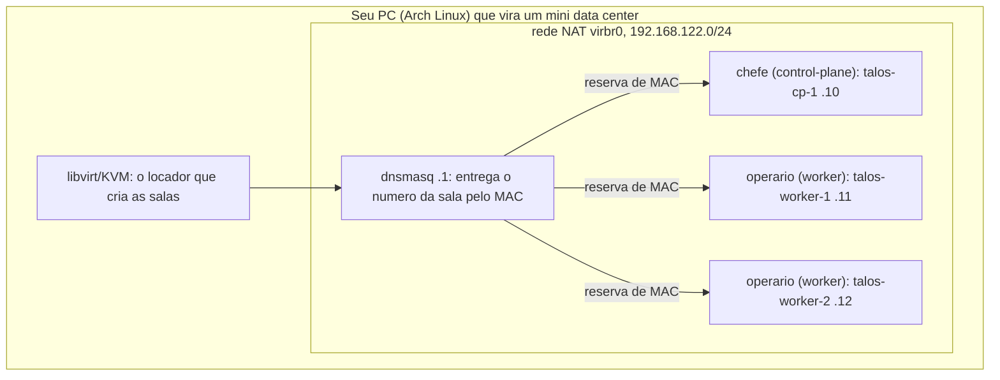
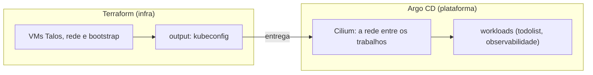
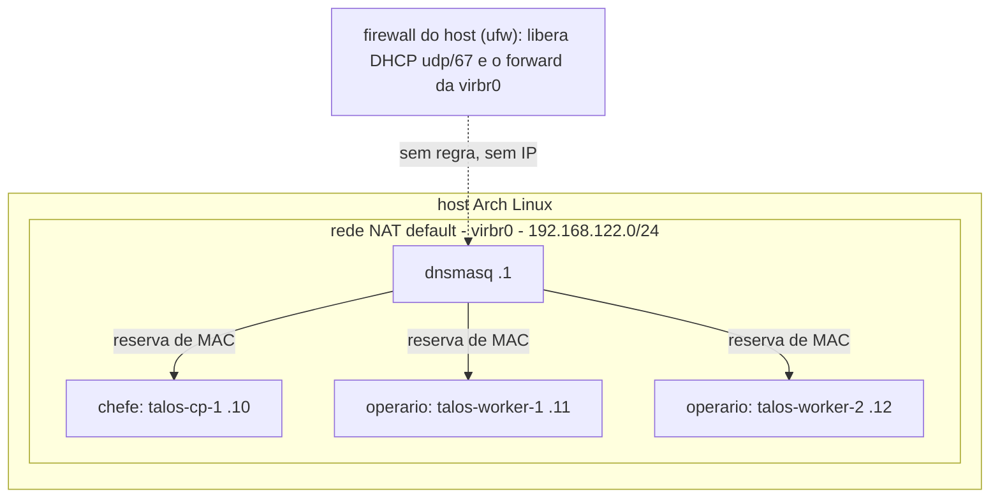
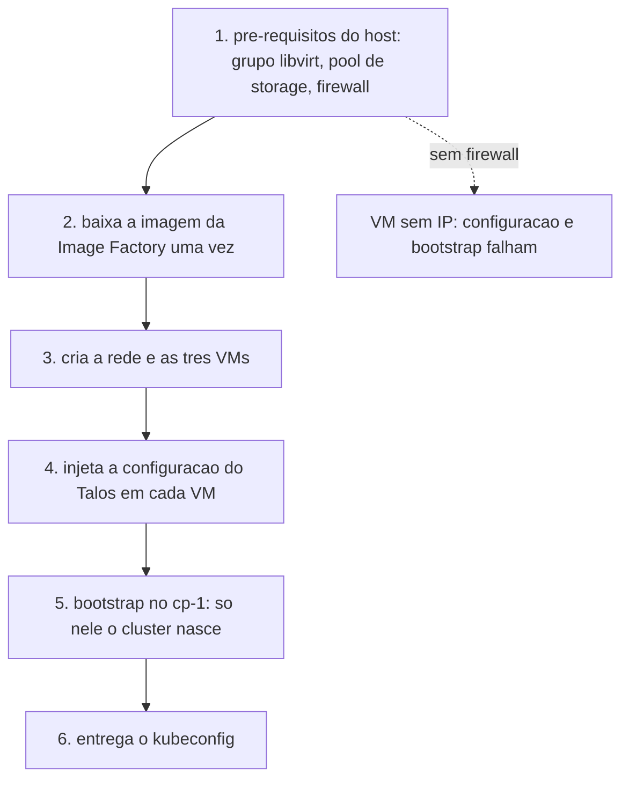
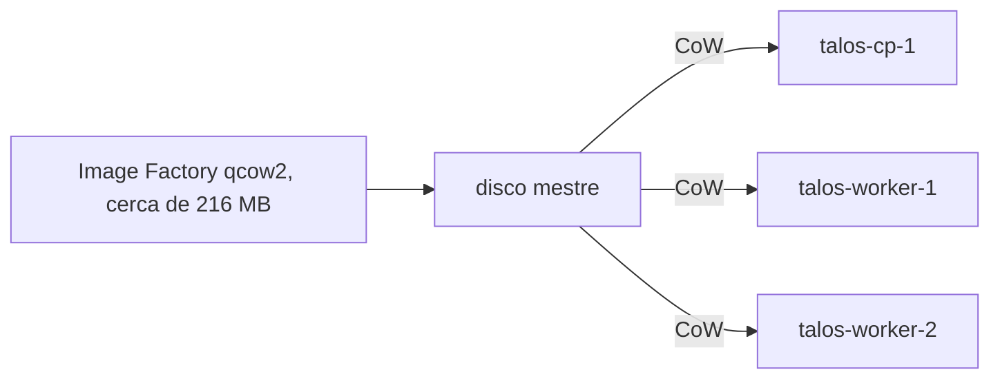
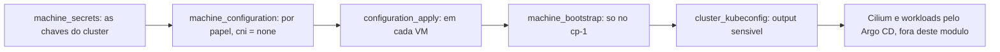

# Terraform: infra Talos em VMs libvirt

Camada de infraestrutura do `k8s-gitops-platform`. Provisiona as VMs com
libvirt e sobe o cluster Talos pelo provider `siderolabs/talos`, devolvendo o
kubeconfig. Os workloads continuam no Argo CD.

## Visao geral (para leigos)

Seu computador finge ser um pequeno data center. Dentro dele, o libvirt cria
tres computadores menores que juntos funcionam como um unico servidor. Um deles
e o chefe, os outros dois sao operarios. Cada caixa do desenho e um computador.



O chefe guarda a lista de quem entrou no cluster. Os operarios rodam os
trabalhos. Nada disso sai do seu computador, a sua rede de casa nao muda.

## Arquitetura

### Quem faz o que

Duas camadas, com uma costura entre elas. O Terraform constroi o cluster e
termina. O Argo CD recebe o kubeconfig e assume dali em diante, incluindo o
Cilium (a rede entre os trabalhos) e as aplicacoes.



O cluster nasce com o CNI desligado (`cni = none`). Sem rede de trabalhos ele
nao serviria para nada, entao o Cilium entra logo depois pelo Argo CD. Esse
corte existe para nao ter duas fontes de verdade da malha.

### Topologia (rede e nos)

O host precisa liberar o DHCP e o encaminhamento da `virbr0`. Sem essa regra a
VM manda o pedido de IP e o dnsmasq nao responde, entao a VM fica sem IP e o
resto da instalacao falha.



### Do host ao cluster (ordem real)



## Para operadores

### Volumes (disco)

Os tres discos sao copias leves de um unico disco mestre. A imagem da Image
Factory e baixada uma vez e cada no recebe uma camada CoW (copy on write) sobre
ela, entao os 20 GiB de cada no nao sao tres downloads completos.



### Provisionamento (Talos)

Os `outputs` `kubeconfig` e `talosconfig` sao sensiveis, entao o valor so sai
por `terraform output` e nunca aparece no log.



## Pre-requisitos no host

- Pacotes: `libvirt`, `qemu-full`, `edk2-ovmf` (firmware UEFI).
- O usuario no grupo `libvirt` para falar com `qemu:///system`:
  `sudo usermod -aG libvirt $USER` (relogar depois).
- Daemon ativo e a rede NAT padrao no ar:
  `sudo systemctl enable --now libvirtd`
  `sudo virsh net-autostart default`
  `sudo virsh net-start default`
- Pool de storage `default` definido e ativo (o libvirt nem sempre o cria):
  `sudo virsh pool-define-as default dir --target /var/lib/libvirt/images`
  `sudo virsh pool-build default`
  `sudo virsh pool-start default`
  `sudo virsh pool-autostart default`
- Firmware UEFI em `/usr/share/edk2/x64/OVMF_CODE.4m.fd` (padrao no Arch).
- Firewall do host (ufw) liberando o DHCP e o forward da `virbr0`. Sem isso as
  VMs mandam o DHCP DISCOVER e o dnsmasq nao responde:
  `sudo ufw allow in on virbr0 from 192.168.122.0/24 to any port 67 proto udp`
  `sudo ufw route allow in on virbr0`
  `sudo ufw route allow out on virbr0`

A rede `default` do libvirt e a NAT em `virbr0` (`192.168.122.0/24`). As VMs
entram nela com IP estatico pedido na interface (`.10` no control plane, `.11`
e `.12` nos workers). Nada na LAN do host muda.

## Imagem

A imagem vem da [Image Factory](https://factory.talos.dev) no formato qcow2, ja
com `qemu-guest-agent` e `iscsi-tools`. O `qemu-guest-agent` permite shutdown
limpo no `destroy`. O schematic usado esta em `image_schematic_id`, com o YAML
no comentario da variavel. Para regerar:

```bash
curl -sS -X POST --data-binary @schematic.yaml https://factory.talos.dev/schematics
```

## Uso

```bash
cd terraform/infra
cp terraform.tfvars.example terraform.tfvars
terraform init
terraform plan
terraform apply
```

Depois do apply:

```bash
terraform output -raw kubeconfig > kubeconfig.yaml
export KUBECONFIG=$PWD/kubeconfig.yaml
kubectl get nodes   # talos-cp-1, talos-worker-1, talos-worker-2
```

Teardown:

```bash
terraform destroy
```

## Outputs

- `kubeconfig` (sensitive), `talosconfig` (sensitive)
- `controlplane_endpoint`, `controlplane_ips`, `worker_ips`, `node_ips`

## Decisoes

- Rede NAT padrao do libvirt (`virbr0`), sem criar rede nova. O IP estatico e
  pedido em `network_interface.addresses`, que o dnsmasq do libvirt reserva.
- Volume base unico, baixado da Image Factory uma vez. Cada no usa uma camada
  CoW sobre ele.
- Rede do Talos com `cni = none`. O Cilium entra na camada do `platform`, para
  nao criar duas fontes de verdade da malha.
- `lifecycle.ignore_changes` em `nvram` e `disk[0].wwn`: o provider gera esses
  valores na criacao e mudam a cada boot, sem serem configuracao.
- Estado local por padrao. Backend remoto (S3 + DynamoDB) comentado em
  `versions.tf`.
