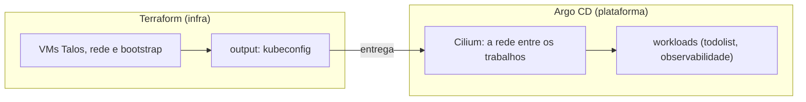
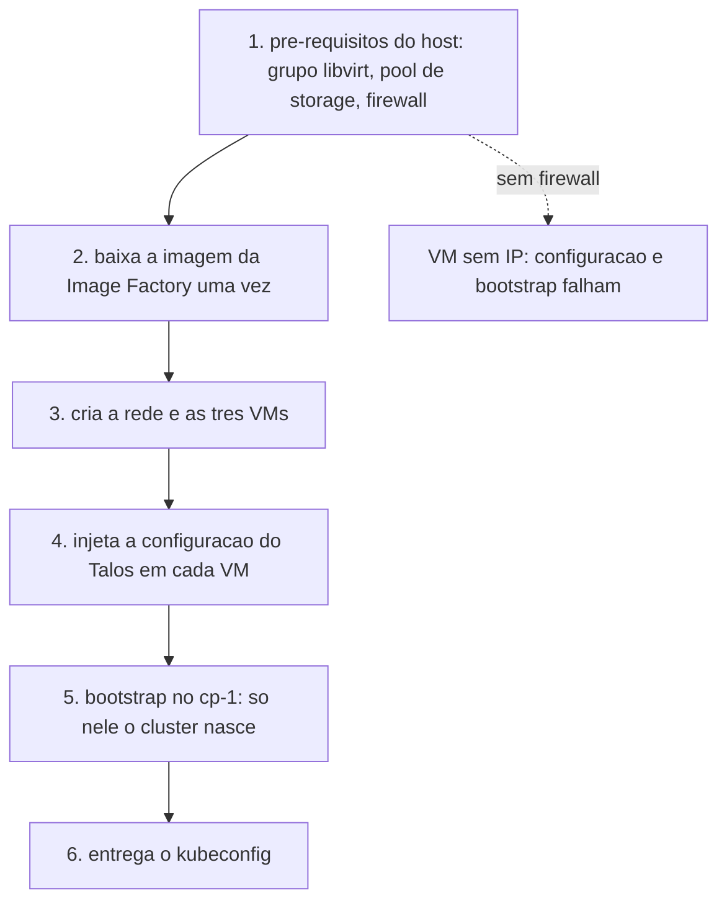
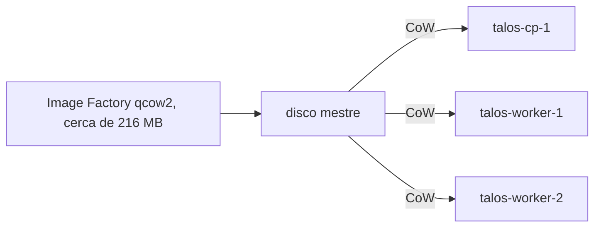
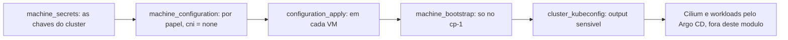

# Terraform: infra Talos em VMs libvirt

Camada de infraestrutura do `k8s-gitops-platform`. Provisiona as VMs com
libvirt e sobe o cluster Talos pelo provider `siderolabs/talos`, devolvendo o
kubeconfig. Os workloads continuam no Argo CD.

## Visao geral (para leigos)

Seu computador finge ser um pequeno data center. Dentro dele, o libvirt cria
tres computadores menores que juntos funcionam como um unico servidor. Um deles
e o chefe, os outros dois sao operarios. Cada caixa do desenho e um computador.


O chefe guarda a lista de quem entrou no cluster. Os operarios rodam os
trabalhos. Nada disso sai do seu computador, a sua rede de casa nao muda.

## Arquitetura

### Quem faz o que

Duas camadas, com uma costura entre elas. O Terraform constroi o cluster e
termina. O Argo CD recebe o kubeconfig e assume dali em diante, incluindo o
Cilium (a rede entre os trabalhos) e as aplicacoes.



O cluster nasce com o CNI desligado (`cni = none`). Sem rede de trabalhos ele
nao serviria para nada, entao o Cilium entra logo depois pelo Argo CD. Esse
corte existe para nao ter duas fontes de verdade da malha.

### Topologia (rede e nos)

O host precisa liberar o DHCP e o encaminhamento da `virbr0`. Sem essa regra a
VM manda o pedido de IP e o dnsmasq nao responde, entao a VM fica sem IP e o
resto da instalacao falha.


### Do host ao cluster (ordem real)



## Para operadores

### Volumes (disco)

Os tres discos sao copias leves de um unico disco mestre. A imagem da Image
Factory e baixada uma vez e cada no recebe uma camada CoW (copy on write) sobre
ela, entao os 20 GiB de cada no nao sao tres downloads completos.



### Provisionamento (Talos)

Os `outputs` `kubeconfig` e `talosconfig` sao sensiveis, entao o valor so sai
por `terraform output` e nunca aparece no log.



## Pre-requisitos no host

- Pacotes: `libvirt`, `qemu-full`, `edk2-ovmf` (firmware UEFI).
- Libvirt/KVM ativo e permissao para acessar a URI libvirt escolhida. Para a
  conexao de sistema, algumas distros pedem adicionar o usuario ao grupo
  `libvirt` e iniciar o servico. A configuracao varia por distribuicao.
- Uma rede libvirt NAT ativa com DHCP e um pool de storage ativo. O script
  detecta a subnet, em vez de exigir que a rede se chame `default`.
- Firmware UEFI OVMF para os nos Talos. O script procura localizacoes comuns;
  `FIRMWARE_PATH` permite indicar outro caminho.
- O firewall do host deve permitir DHCP e encaminhamento da bridge NAT. As
  regras variam com a ferramenta e a subnet detectada. O preflight nao altera
  firewall nem rede; consulte o administrador local se o DHCP falhar.

### Setup portavel em outro host Linux

O projeto nao deve depender do CIDR da rede, do IP do host na LAN nem de um
caminho unico de firmware. O script `setup-host.sh` detecta a rede e o pool
libvirt escolhidos, acha um firmware UEFI conhecido, verifica ferramentas e
recursos, cria configuracao local e renderiza o Ingress com o IP derivado da
rede. Nao instala pacotes, nao altera a rede/firewall e nao usa sudo.

Requisito recomendado para subir o cluster completo (control plane, dois
workers e MinIO): 8 CPUs, 16 GiB de RAM e 80 GiB livres no pool. O MinIO
isolado precisa de 1 CPU, 2 GiB de RAM e 20 GiB de disco. Abaixo do recomendado
o script avisa, mas deixa a decisao ao operador.

Instale os pacotes de virtualizacao e firmware UEFI usando o gerenciador da
sua distribuicao. O preflight identifica ferramentas ausentes. Exemplos:

| Distribuicao | Pacotes adicionais para este Terraform |
| --- | --- |
| Arch Linux | `libvirt`, `qemu-full`, `edk2-ovmf`, `cdrtools` |
| Debian/Ubuntu | `libvirt-daemon-system`, `qemu-system-x86`, `ovmf`, `genisoimage` |
| Fedora | `libvirt`, `qemu-kvm`, `edk2-ovmf`, `genisoimage` |

Garanta que o servico libvirt esta ativo, a rede NAT e o pool de storage estao
ativos e o usuario tem permissao de conexao. Se usar nomes/URI diferentes dos
defaults, exporte `LIBVIRT_URI`, `LIBVIRT_NETWORK` e `LIBVIRT_POOL`. Se o
firmware nao estiver em um dos caminhos comuns, exporte `FIRMWARE_PATH`.

```bash
cd terraform/infra
./setup-host.sh
terraform init
terraform plan
terraform apply
```

O script gera `terraform.tfvars` com permissao 600 (ignorado pelo Git), uma
senha MinIO aleatoria e a chave publica SSH do operador. Pode-se fornecer a
chave com `MINIO_SSH_PUBKEY` ou a senha com `MINIO_ROOT_PASSWORD` antes de
rodar. O CIDR e obtido do XML da rede libvirt, nao de uma constante do projeto.
O Ingress gerado em `terraform/infra/minio-console-ingress.yaml` tambem e local
e ignorado pelo Git. O MinIO fica fora do cluster de proposito: ele simula a
AWS para os backups do Postgres com wal-g no futuro.

Depois do apply, a API S3 esta em `terraform output -raw minio_endpoint`; o
console e `http://minio.localhost` quando o cluster Talos, Traefik e o Ingress
estiverem ativos. Enquanto isso, o console pode ser acessado diretamente em
`http://<IP-MinIO>:9001`, usando o hostnum configurado. A API e o console
permanecem na NAT do libvirt, sem publicacao na LAN.

Para outra rede libvirt, o script detecta o CIDR mas reserva os host numbers
10 para o primeiro control plane, 11 em diante para workers e 20 para MinIO.
Confirme que esses enderecos cabem na subnet e nao conflitam com dispositivos
existentes. Personalize `controlplane_hostnum_start`, `worker_hostnum_start` e
`minio_hostnum` no `terraform.tfvars` local se necessario.

As VMs entram na rede NAT detectada com enderecos fixados por reserva DHCP
derivada do CIDR local (host numbers 10 em diante para Talos e 20 para MinIO).
Nada na LAN do host muda.

## Imagem

A imagem vem da [Image Factory](https://factory.talos.dev) no formato qcow2, ja
com `qemu-guest-agent` e `iscsi-tools`. O `qemu-guest-agent` permite shutdown
limpo no `destroy`. O schematic usado esta em `image_schematic_id`, com o YAML
no comentario da variavel. Para regerar:

```bash
curl -sS -X POST --data-binary @schematic.yaml https://factory.talos.dev/schematics
```

## Uso

```bash
cd terraform/infra
cp terraform.tfvars.example terraform.tfvars
terraform init
terraform plan
terraform apply
```

Depois do apply:

```bash
terraform output -raw kubeconfig > kubeconfig.yaml
export KUBECONFIG=$PWD/kubeconfig.yaml
kubectl get nodes   # talos-cp-1, talos-worker-1, talos-worker-2
```

Teardown:

```bash
terraform destroy
```

## Outputs

- `kubeconfig` (sensitive), `talosconfig` (sensitive)
- `controlplane_endpoint`, `controlplane_ips`, `worker_ips`, `node_ips`

## Decisoes

- Rede NAT padrao do libvirt (`virbr0`), sem criar rede nova. O IP estatico e
  pedido em `network_interface.addresses`, que o dnsmasq do libvirt reserva.
- Volume base unico, baixado da Image Factory uma vez. Cada no usa uma camada
  CoW sobre ele.
- Rede do Talos com `cni = none` e `proxy.disabled = true`. O Cilium entra na
  camada do `platform` em modo kube-proxy-free, para nao criar duas fontes de
  verdade da malha nem deixar o kube-proxy brigando pelas mesmas rotas.
- `lifecycle.ignore_changes` em `nvram` e `disk[0].wwn`: o provider gera esses
  valores na criacao e mudam a cada boot, sem serem configuracao.
- Estado local por padrao. Backend remoto (S3 + DynamoDB) comentado em
  `versions.tf`.
