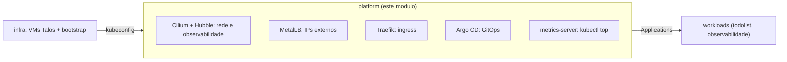
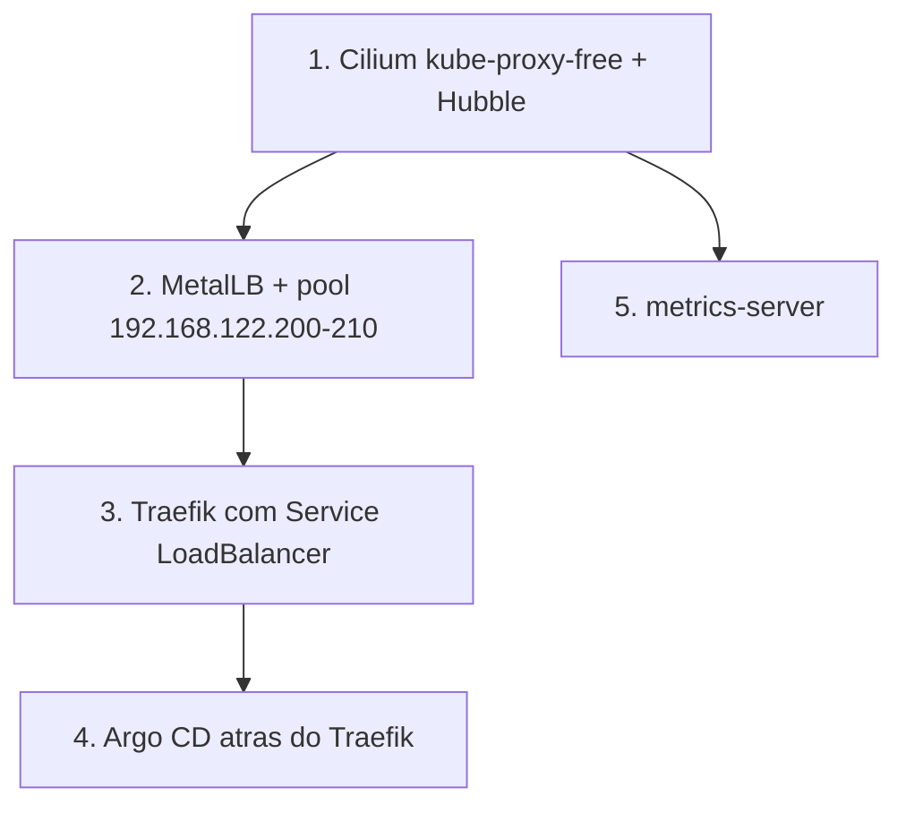

# Terraform: plataforma do cluster

Camada de plataforma do `k8s-gitops-platform`. Aplica sobre o kubeconfig vindo
do modulo `infra` e instala a base que o cluster precisa para servir workloads:
Cilium (rede dos pods), MetalLB (IPs de LoadBalancer), Traefik (ingress),
Argo CD (GitOps) e metrics-server. Os workloads continuam entregues pelo
Argo CD.

## Visao geral (para leigos)

O modulo `infra` entregou tres computadores vazios e um cluster sem rede entre
os trabalhos. Este modulo coloca a fiacao: a rede que liga os trabalhos, a
porta de entrada da internet, o painel que entrega as aplicacoes e o medidor de
consumo de cada maquina.

## Arquitetura

### Quem faz o que



### Ordem da instalacao



O Cilium vem primeiro porque e o CNI. Ate ele subir, os nos ficam `NotReady` e
nada mais tem onde rodar. O Traefik espera o MetalLB para ganhar IP externo. O
Argo CD espera o Traefik para ficar acessivel pelo Ingress.

## Para operadores

### Cilium no Talos

O Talos exige ajustes no Cilium que nao aparecem em outros clusters. Os valores
ficam na `local.cilium_values` de `main.tf`, com o motivo de cada um no
comentario.

- KubePrism: o Talos expoe o kube-apiserver em `localhost:7445` em cada no. O
  Cilium usa isso como `k8sServiceHost`, sem depender de Service do Kubernetes.
- Sem `SYS_MODULE`: o Talos nao deixa workload carregar modulo de kernel. O
  init container `clean-cilium-state` morre com `unable to apply caps` se a
  capability ficar.
- `cgroup.autoMount` desligado e `hostRoot` em `/sys/fs/cgroup`: reusa o
  cgroupv2 que o Talos ja monta.
- `bpf.hostLegacyRouting: true`: o forwarding de DNS do kube-dns para o host,
  padrao no Talos 1.8+, nao funciona junto com o host-routing eBPF.

O kube-proxy do Talos fica desligado pelo `infra` (`cluster.proxy.disabled`),
porque os dois juntos brigariam pelas mesmas rotas.

### Pod Security Admission

O Talos aplica Pod Security Admission no nivel `baseline` por padrao. O speaker
do MetalLB usa `hostNetwork` e a capability `NET_RAW`, entao o namespace
`metallb-system` e criado por um `kubectl_manifest` com o rotulo
`pod-security.kubernetes.io/enforce=privileged` antes do chart. O
`create_namespace` do Helm criaria um namespace sem rotulo e os pods seriam
barrados.

### Acesso

Os hosts resolvem para loopback (RFC 6761), sem DNS externo nem `/etc/hosts`:

- Argo CD: `http://argocd.localhost`
- Hubble UI: `http://hubble.localhost`

O Traefik recebe um IP do pool do MetalLB (`192.168.122.200`). Para testar sem
editar hosts:

```bash
curl -H "Host: argocd.localhost" http://192.168.122.200/
```

## Uso

```bash
cd terraform/infra
terraform output -raw kubeconfig > ~/.kube/talos-kubeconfig

cd ../platform
cp terraform.tfvars.example terraform.tfvars
terraform init
terraform plan
terraform apply
```

Depois do apply, com o kubeconfig exportado:

```bash
kubectl get nodes            # os tres nos Ready
kubectl top nodes            # metrics-server respondendo
kubectl -n traefik get svc   # EXTERNAL-IP 192.168.122.200
```

Teardown:

```bash
terraform destroy
```

## Decisoes

- Componentes de plataforma via Helm no Terraform, nao por Argo CD. O Argo CD
  precisa de rede, ingress e IP externo para existir, entao esses quatro vem
  antes dele. Depois disso o Argo CD e a fonte de verdade dos workloads.
- `kubectl_manifest` para as CRs do MetalLB. O `kubernetes_manifest` resolveria
  o tipo no plan e quebraria o primeiro apply, quando a CRD ainda nao existe.
- Pool do MetalLB no fim da rede NAT (`192.168.122.200-210`), longe das VMs
  (`.10-.12`).
- `frrk8s` desligado, porque o pool e anunciado em L2 e o backend FRR seria peso
  morto.
- metrics-server com `--kubelet-insecure-tls`, porque o kubelet do Talos usa
  certificado self-signed.
